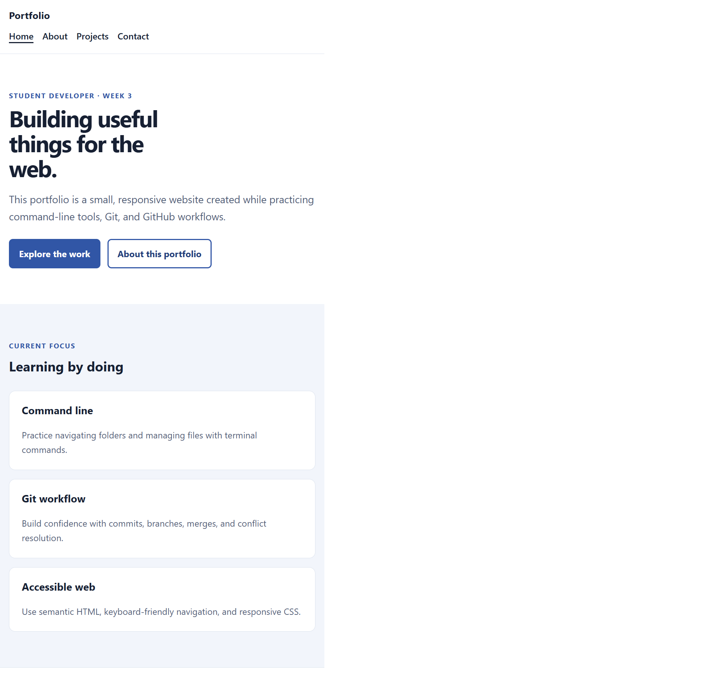

# Week 3 Tools & Workflow Portfolio

A responsive, multi-page portfolio created for Week 3 practice with HTML, CSS, the command line, and Git.

## Live Demo

Not published yet. After creating the public GitHub repository and enabling GitHub Pages, add the live URL here.

## Screenshot



## Features

- Responsive multi-page layout
- Semantic HTML and keyboard-friendly skip link
- Visible focus states and reduced-motion support
- Navigation hover and current-page underline
- Mobile layout breakpoint for project cards and navigation

## Technologies Used

- HTML5
- CSS3 (Grid, Flexbox, custom properties)
- Bash
- Git and GitHub (complete the remote workflow before claiming publication)

## Project Structure

```text
week-03/
├── about.html
├── contact.html
├── index.html
├── projects.html
├── css/
│   └── styles.css
├── images/
│   ├── README.md
│   └── screenshot.png
├── daily-challenge-1/
│   ├── README.md
│   └── src/
│       ├── index.html
│       ├── css/style.css
│       └── js/app.js
├── scripts/
│   ├── boilerplate.sh
│   └── new-project.sh
├── .gitignore
├── LICENSE
├── README.md
├── terminal-log.md
└── WEEK-3-ANSWERS.md
```

## What I Learned

Week 3 focuses on navigating and manipulating files from a terminal, searching project files, writing small shell scripts, and using Git to track changes. The exercises also cover branching, merging, resolving conflicts, and working with GitHub remotes.

## Future Improvements

- [ ] Copy in the actual Week 2 portfolio before creating the graded repository
- [ ] Personalize the About page and add real project work
- [ ] Publish with GitHub Pages
- [ ] Complete the pair collaboration lab and add verified PR links
- [ ] Replace the copyright holder placeholder in `LICENSE`

## Contact

Add only public contact details you want to share:

- Email: not provided
- GitHub: add your profile after confirming your username

## Collaboration

The pair lab has not been completed in this workspace. Add these verified links after working with your assigned partner:

- Partner: pending
- Pair repository: pending
- PR I opened: pending
- PR I reviewed: pending
- Merge-conflict PR: pending

## Challenges Faced

No merge-conflict exercise has been completed yet. After completing it, describe the conflicting line, how you chose the final content, and link to the resulting merge commit or pull request. Do not report a conflict that you did not actually resolve.

## License

This project is available under the MIT License. See [LICENSE](LICENSE).
